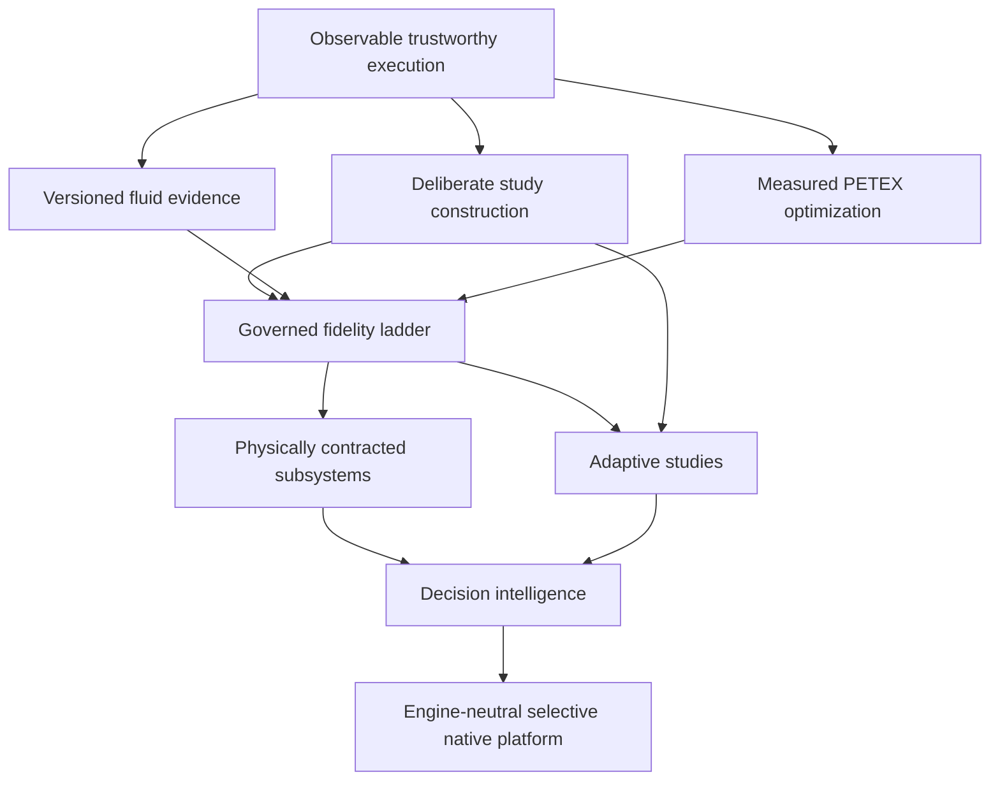

# Long-Term North Star

Status: long-term product and engineering vision, 2026-09-10. This records the
direction as I currently think it should be pursued. It is not a calendar,
funding commitment, or permission to change production physics. The phases are
ordered by evidential dependency; some research can proceed in parallel when it
does not weaken those dependencies.

## The Destination

Autogration should become a **decision-grade engineering computation platform**.

An engineer should be able to state a field-development or operating decision,
its alternatives, constraints, uncertainty, and available evidence. Autogration
should then compile that question into the smallest defensible set of
calculations, coordinate the appropriate engines and fidelities, learn where
more evidence is valuable, and produce a reproducible record of what the
evidence supports.

```text
Decision question
  -> alternatives, constraints, and uncertainty
  -> calculation and evidence graph
  -> cheapest eligible evaluators
  -> selective trusted full-physics execution
  -> quality, uncertainty, and decision checks
  -> reviewable engineering evidence
```

The phrase that governs the vision is **smallest defensible calculation**. It
does not mean the smallest or fastest model. It means the least expensive body
of computation that preserves the physics, constraints, uncertainty, and
decision relevant to the declared question.

PETEX remains a trusted integrated-physics stack. WhitsonPVT can become a
trusted fluid-evidence and fluid-model source. Other approved commercial, open,
analytical, reduced, and eventually native evaluators can join them. Autogration
becomes the system that understands the study, selects and governs the work,
and retains the chain of evidence.

## Why This Is Worth Building

The present problem is larger than simulation speed:

- Cartesian studies can spend heavily without learning proportionally more.
- A few visible controls can trigger many hidden coupled and physical
  evaluations.
- Model, data, PVT, settings, engine, and result identity are difficult to
  compare over time.
- Every case is commonly charged the cost of the same fidelity even where a
  bounded cheaper representation could answer the question.
- Existing calculations are difficult to reuse with an honest equivalence
  claim.
- Scenario ranges can be mistaken for probability distributions.
- Results are often converted into decisions through manual, fragmented work.

The long-term opportunity is to improve the whole path from question to
decision: less wasted computation, stronger physical and statistical claims,
faster learning, clearer review, and a durable organizational memory of what
was calculated and why.

## What Autogration Should Own

Autogration should own:

- the decision and study specification;
- immutable revisions and semantic case identity;
- the calculation/evidence graph and dependency fingerprints;
- study design, sampling, budgets, admission, and queueing;
- evaluator and fidelity selection under explicit policy;
- execution coordination and retry lineage;
- result quality, comparison, uncertainty, and validity evidence;
- adaptive next-case and stopping rationale; and
- the final review package and the conditions that could overturn it.

Autogration should not silently own engineering judgement it cannot justify. A
responsible engineer remains accountable for physical assumptions, limits,
uncertainty declarations, acceptance tolerances, and field action. Calculation
engines remain responsible for their declared physics.

## The Product In Its Mature Form

The mature system is a study compiler with a fidelity ladder. Each calculation
node declares:

- the quantity or question it answers;
- inputs, units, dependencies, and output contract;
- eligible evaluators;
- expected cost and operational requirements;
- validity envelope and known exclusions;
- validation and uncertainty evidence;
- conditions requiring escalation; and
- whether a prior result is exactly reusable.

An evaluator ladder could contain:

```text
Exact approved result reuse
  -> validated table or interpolation
  -> approved well/facility response
  -> analytical or material-balance model
  -> reduced subsystem or numerical model
  -> trusted full RESOLVE/PETEX execution
```

Autogration should spend high fidelity near phase changes, event boundaries,
active constraints, uncertain regimes, and close decisions. It should use
cheaper evidence only where the declared contract permits it, and it should
explain every choice.

## The Journey

### Phase 1: Make present execution observable and trustworthy

Turn the current PETEX runner into an evidence-producing execution system.

Build immutable study/case identity, complete model/data/settings/PVT/output
fingerprints, attempt and retry lineage, result-quality status, runtime and
calculation telemetry, and a representative reference-case corpus.

**Motivation:** none of the later claims are credible if two results cannot be
shown to represent the same question or if runtime cannot be attributed.

**Exit evidence:** an engineer can reconstruct what ran, why it ran, what it
used, whether it completed acceptably, where its time went, and whether another
result is comparable.

Runtime optimization of the existing PETEX path is the first focused technical
program inside this phase. It is developed separately because it requires a
more detailed experimental and integration design.

### Phase 2: Make study construction deliberate

Replace Cartesian-by-default thinking with explicit full-factorial,
sensitivity, screening, and probability-sampling modes. Add exact
canonicalization, declarative applicability rules, admission budgets, and
transparent reuse.

**Motivation:** the cheapest trusted simulation is the one that adds no new
information and therefore does not need to run.

**Exit evidence:** held-out comparisons show that reduced study plans preserve
the declared conclusion and material constraint findings; probability claims
come only from a declared probability or weighted-realization plan.

### Phase 3: Make fluid models first-class evidence

Represent source samples, laboratory evidence, QC, parent EOS/viscosity model,
component mapping, child model, target-engine materialization, and validity
envelope as versioned dependencies. Use WhitsonPVT through a read-oriented,
snapshot-based provider contract if the real tenant API and export path support
it.

**Motivation:** PVT is simultaneously a major cross-engine consistency risk, a
source of coherent uncertainty, and a possible route to cheaper repeated
physical evaluations.

**Exit evidence:** every case can reproduce its PVT artifact and explain its
source; detailed, lumped, or black-oil representations are selected only inside
validated conditions.

### Phase 4: Optimize the trusted execution stack

Use measured bottlenecks to test PETEX-supported changes to lifecycle reuse,
responses, PVT representation, timestep and event policy, coupling,
optimization, and parallelism. Preserve one-factor attribution before combining
compatible wins.

**Motivation:** large end-to-end gains often come from eliminating repeated
expensive work, not replacing a nonlinear algorithm in isolation.

**Exit evidence:** repeatable wall-time or throughput gains survive comparison
on frozen cases without changing required convergence, balances, phases,
constraints, feasible alternatives, or decision KPIs.

### Phase 5: Establish a governed fidelity ladder

Introduce bounded cheaper evaluators in shadow mode: approved PVT tables,
PROSPER/well responses, facility responses, analytical IPR, MBAL or streamline
screening, reduced reservoir models, and other narrow responses. Record local
validation envelopes and automatic escalation rules.

**Motivation:** uniform maximum fidelity spends computation where it may not
change the answer; uniform low fidelity hides where it will.

**Exit evidence:** evaluator choice is reproducible, out-of-domain cases
escalate, and held-out trusted-engine comparisons preserve decision and
constraint outcomes.

### Phase 6: Support physically contracted subsystems

Progress from exact disconnection to fixed boundaries, calibrated boundary
responses, and iterative co-simulation. Every omitted domain becomes an
explicit interface in pressure, rate, temperature, composition, and control
state.

**Motivation:** some assets or components can be calculated separately or less
often, but statistical correlation is not evidence of physical independence.

**Exit evidence:** interface residuals, event behavior, and held-out full-model
comparisons define where separation is valid and when monolithic execution is
mandatory.

### Phase 7: Make studies adaptive

Begin with transparent, deterministic next-case rules based on coverage,
sensitivity, constraint proximity, and disagreement between decisions. Later
use calibrated local surrogates to propose work, while keeping representative
probability samples and trusted confirmation distinct.

**Motivation:** a study should spend its next calculation where it can most
reduce decision uncertainty, rather than complete a predetermined grid whose
remaining cases no longer matter.

**Exit evidence:** a logged sequential plan reaches the same held-out decision
with fewer expensive calls and stops for a declared evidential reason.

### Phase 8: Add decision intelligence

Represent named alternatives, coherent uncertainty realizations, constraint
risk, decision stability, value of information, and eventually governed
economics. Publish evidence and reversal conditions before recommending action.

**Motivation:** simulations are means; the organizational objective is a better
engineering decision with known assumptions and residual risk.

**Exit evidence:** reviewers can see which alternative is supported, under
which assumptions, how stable the result is, what could reverse it, and which
new evidence would be worth buying.

### Phase 9: Become engine-neutral and selectively native

Give trusted commercial engines, WhitsonPVT, open research references,
analytical services, approved responses, and narrow native kernels a common
execution and evidence contract. Develop native capabilities only where the
boundary is stable and independent verification is practical.

**Motivation:** the engineering question should choose the calculation, while
PETEX can remain the full-stack reference and confirmation engine.

**Exit evidence:** multiple evaluators can answer the same declared output
contract, their validity is explicit, and no production role is granted on
architectural preference alone.

## How The Phases Relate



This is not a strict single-file delivery sequence. Runtime measurement,
licensed PETEX evidence acquisition, and a read-only WhitsonPVT feasibility
spike can proceed concurrently. Approximation, adaptivity, and decision claims
must still wait for the identity, quality, and validation contracts they need.

## Engineering Method

Every important capability should pass the same progression:

1. **Claim:** state exactly what is expected to improve and why.
2. **Boundary:** identify the owner, dependencies, and quantities that may
   change.
3. **Reference:** freeze representative normal, difficult, extreme, and event
   cases.
4. **Measure:** capture cost, quality, constraints, and decision outputs.
5. **Isolate:** test one mechanism before stacking changes.
6. **Falsify:** define the result that would reject the idea.
7. **Shadow:** compare beside the trusted path without controlling a decision.
8. **Certify locally:** approve a bounded envelope, not a universal claim.
9. **Escalate:** return to trusted full physics when the envelope is left.
10. **Retire evidence:** invalidate reuse and certificates when dependencies
    change.

This method is how a long-term research project avoids becoming either a
collection of impressive prototypes or an opaque optimization layer.

## Principles That Should Survive The Whole Project

1. Preserve meaning before reducing cost.
2. Measure computation rather than infer it from visible model controls.
3. Separate exact reuse from approximation.
4. Separate scenario, learning, and probability samples.
5. Treat constraints and phase changes as first-class outputs, not secondary
   error statistics.
6. Validate decisions, not only average rates.
7. Prefer local validity envelopes to universal surrogate claims.
8. Keep trusted full-engine confirmation available.
9. Make human engineering judgement and ownership explicit.
10. Let evidence close or reorder branches; do not defend a roadmap against its
    own measurements.

## A Mature Example

For a question such as whether to expand compression or add a well,
Autogration should eventually:

1. Freeze the alternatives, constraints, horizon, reservoir/PVT/operational
   realizations, and decision criteria.
2. Reuse exact unchanged evidence and approved responses.
3. Screen broad alternatives with bounded cheaper evaluators.
4. Run trusted integrated physics near phase, facility, and decision
   boundaries.
5. Add cases where the alternatives remain difficult to distinguish.
6. Confirm representative central, tail, event, and constraint cases through
   the full trusted stack.
7. Report the supported choice, uncertainty, limitations, and conditions that
   would reverse it.

The mature value is not that Autogration always avoids RESOLVE. It is that every
RESOLVE run, approximation, reuse decision, and additional experiment has a
defensible reason connected to the engineering decision.

## Immediate Strategic Focus

The long horizon does not make the first move ambiguous. The first program is
to make the current RESOLVE execution measurable and then investigate how to
remove repeated work in the manner suggested by PETEX's historical performance
case and by other established performance mechanisms.

That program must answer four things before product implementation is chosen:

1. Where time and repeated calculations occur in representative Autogration
   executions.
2. Which PETEX-supported levers exist in the licensed versions and models.
3. Which changes preserve the engineering output and constraints.
4. Which responsibilities belong in PETEX models, the node executor,
   Autogration's study layer, infrastructure, or a future evaluator service.

The companion runtime investigation should therefore be detailed and
implementation-aware, but it should remain a proposed proof program until
reference cases, engineering tolerances, and vendor-supported mechanisms are
agreed.